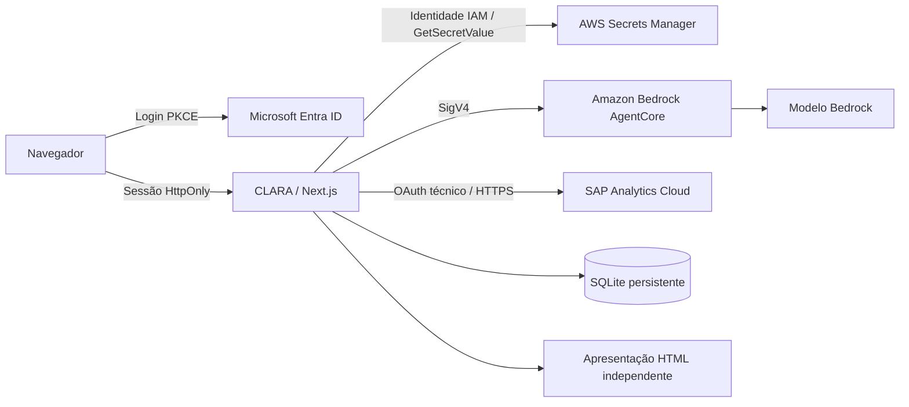

# Configuração da CLARA

Guia de implantação e operação. Revisto em 18/10/2026. Código da aplicação: `app/`.

## Ordem recomendada

1. [Preparar o ambiente e as variáveis](01-AMBIENTE.md).
2. [Configurar AWS, Bedrock, AgentCore e Secrets Manager](02-AWS.md).
3. [Configurar Microsoft Entra ID / AD](03-MICROSOFT.md).
4. [Configurar SAP Analytics Cloud e validar o contrato](04-SAP.md).
5. [Validar, operar e resolver problemas](05-OPERACAO.md).

Referências entregues junto ao guia:

- [Modelo completo de ambiente](../../app/.env.runtime.example).
- [Contrato OpenAPI SAP em JSON](../SAP-OPENAPI.json), também servido em `GET /api/v1/sap/openapi`.
- [Contrato principal do Studio](../../app/src/studio/contracts.ts), servido em `GET /api/v1/studio/openapi`.
- [Implementação do conector SAP](../../app/src/server/sac.ts).
- [Carregamento de segredos](../../app/src/server/secrets.ts).
- [Modelo visual das apresentações](../../app/src/server/studio/executiveTemplate.ts).

## Arquitetura

O servidor valida sessão, espaço, papel e modelos SAP autorizados. A IA recebe o catálogo e agregações autorizadas; não recebe credenciais. Suas propostas seguem um contrato JSON e são conferidas pela aplicação. O HTML executivo é gerado por um template controlado, com dados calculados no servidor e textos escapados.

## Situação desta entrega

| Item | Situação |
|---|---|
| Interface | Texto explicativo de papéis e botão de ajuda removidos |
| Apresentações | Novo template BTG, slides 16:9, indicadores, gráficos e apêndice de valores |
| SAP Analytics Cloud | Endpoints e contrato implementados; tenant, modelos e credencial serão configurados posteriormente |
| Secrets Manager | Carregamento no início da aplicação implementado; exemplos não incluem valores secretos |
| TypeSafe | Integração e chave local removidas a pedido do usuário; nenhuma transferência para AWS |
| Haiku 5.5 | Catálogo e perfil `us.anthropic.claude-haiku-5-5` confirmados; invocação recusada nesta conta pela AWS |
| AgentCore do piloto | Endpoint existente preservado com Nova 2 Lite até a liberação do Haiku |
| Grupo administrativo Entra | A implantação precisa preencher o ID real de `CLARA-Administradores-Plataforma`; não há liberação por e-mail |

O teste real do Haiku retornou `AccessDeniedException` informando indisponibilidade para a conta. A consulta de disponibilidade mostrou região e entitlement disponíveis, mas `agreementAvailability.status=NOT_AVAILABLE`. Não basta alterar a variável: é necessário obter a liberação da AWS e atualizar a versão do harness. Veja o procedimento e o rollback no [guia AWS](02-AWS.md).

## Limites da entrega

O adaptador SAP cobre leitura do Data Export Service, com OAuth Client Credentials. Não executa importação **para** o SAP, criação de subscriptions, deltas, `$batch`, execução de SQL ou autenticação SAP por usuário. As consultas reais dependerão do tenant, licença e modelos escolhidos. A homologação aqui usa respostas simuladas do contrato; não representa conexão validada com um tenant corporativo.

O armazenamento atual é SQLite: execute uma instância com volume persistente. Várias réplicas independentes não compartilham sessões, créditos e dashboards. Para escalar horizontalmente, migre primeiro o repositório e as operações transacionais.
